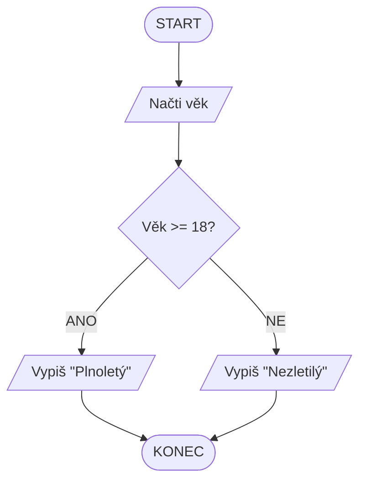
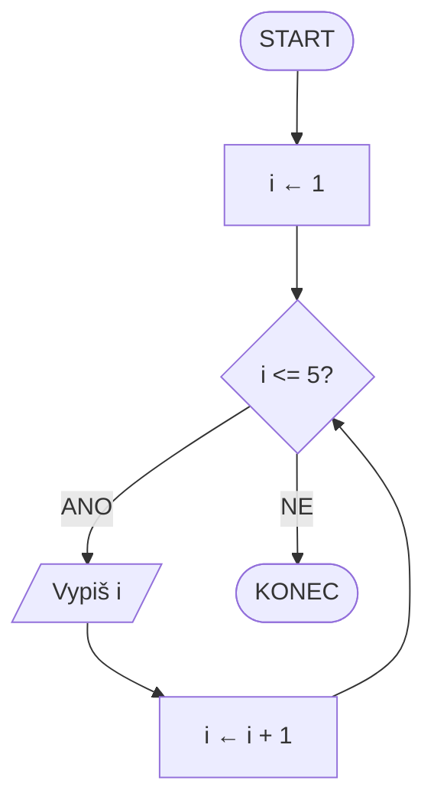

# Algoritmy a algoritmické myšlení

Programování není pouze zapisování příkazů v určitém programovacím jazyce. Nejdříve je potřeba pochopit problém, navrhnout postup jeho řešení a teprve potom jej převést do zdrojového kódu.

Takový postup označujeme jako **algoritmus**.

## 1. Co je algoritmus?

**Algoritmus** je přesně popsaný postup, který vede k vyřešení určitého problému nebo splnění úkolu.

S algoritmy se setkáváme i v běžném životě. Příkladem může být recept na přípravu jídla, návod na sestavení nábytku nebo postup při řešení matematické úlohy.

### Příklad – Výpočet obsahu obdélníku

Chceme vypočítat obsah obdélníku na základě délky jeho stran.

Postup:

1. Zjistíme délku strany `a`.
2. Zjistíme délku strany `b`.
3. Vynásobíme obě hodnoty.
4. Vypíšeme výsledek.

Matematicky můžeme výpočet vyjádřit vztahem `S = a * b`.

Algoritmus popisuje jednotlivé kroky řešení. Zatím nezáleží na tom, v jakém programovacím jazyce jej později zapíšeme.

## 2. Vlastnosti algoritmu

Aby byl postup použitelný jako algoritmus, měl by splňovat několik základních vlastností.

| Vlastnost | Význam |
|---|---|
| Konečnost | Pro přípustné vstupy musí algoritmus po konečném počtu kroků skončit |
| Jednoznačnost | Každý krok musí být dostatečně přesně určen |
| Hromadnost | Stejný postup lze použít pro celou skupinu podobných úloh |
| Výslednost | Pro přípustné vstupy musí algoritmus poskytovat výsledek odpovídající zadání |
| Elementárnost | Jednotlivé kroky musí být vykonatelné |

### Příklad – Nejednoznačný postup

Uvažujme následující zadání:

1. Zadej číslo.
2. Nějak jej uprav.
3. Vypiš výsledek.

Tento postup není dostatečně jednoznačný. Není totiž jasné, jak má být číslo upraveno.

Přesnější zápis:

1. Zadej číslo.
2. Vynásob jej dvěma.
3. Vypiš výsledek.

Každý krok má nyní jasně určený význam.

## 3. Vstup, zpracování a výstup

Většinu jednoduchých programů můžeme rozdělit na tři základní části:

| Část | Význam |
|---|---|
| Vstup | Údaje, které algoritmus potřebuje |
| Zpracování | Operace prováděné nad vstupními údaji |
| Výstup | Výsledek činnosti algoritmu |

### Příklad – Výpočet průměru

Chceme vypočítat průměr tří čísel.

- **Vstup:** Tři zadaná čísla
- **Zpracování:** Sečtení čísel a vydělení součtu třemi
- **Výstup:** Vypočítaný průměr

Například pro čísla 6, 9 a 12 dostaneme `(6 + 9 + 12) / 3 = 9`.

Při návrhu programu je užitečné nejprve určit, jaké údaje potřebujeme, co s nimi budeme dělat a jaký výsledek očekáváme.

## 4. Základní algoritmické konstrukce

Programy jsou sestavovány z několika základních konstrukcí, které určují pořadí vykonávání jednotlivých kroků.

### Sekvence

**Sekvence** představuje posloupnost příkazů, které se vykonávají postupně v určeném pořadí.

Příklad:

1. Načti dvě čísla.
2. Sečti je.
3. Vypiš součet.

Každý krok se provede po dokončení předchozího kroku.

### Větvení

**Větvení** umožňuje zvolit různé postupy podle splnění určité podmínky.

Příklad:

1. Zjisti věk uživatele.
2. Pokud je věk alespoň 18 let, vypiš „Plnoletý“.
3. Jinak vypiš „Nezletilý“.

Algoritmus se rozhoduje mezi dvěma možnostmi.

### Opakování

**Opakování neboli cyklus** umožňuje provádět určité kroky vícekrát.

Příklad:

1. Nastav počítadlo na hodnotu 1.
2. Vypiš hodnotu počítadla.
3. Zvyš počítadlo o 1.
4. Pokud je počítadlo nejvýše 5, vrať se ke kroku 2.
5. Ukonči algoritmus.

Výsledkem bude vypsání čísel od 1 do 5.

Sekvence, větvení a opakování tvoří základ většiny programů. Jejich konkrétní zápis v Pythonu se naučíme v dalších lekcích.

## 5. Principy algoritmického myšlení

Algoritmické myšlení představuje schopnost analyzovat problém a navrhnout postup jeho řešení.

Při řešení problémů využíváme čtyři vzájemně propojené principy.

### Dekompozice

**Dekompozice** je rozdělení složitého problému na menší části, které lze řešit samostatně.

#### Příklad – Jednoduchá kalkulačka

Chceme vytvořit program, který vypočítá součet dvou čísel.

1. Získání prvního čísla
2. Získání druhého čísla
3. Výpočet součtu
4. Zobrazení výsledku

Každá část má konkrétní účel. Rozdělení problému usnadňuje návrh řešení i hledání případných chyb.

### Rozpoznávání vzorů

**Rozpoznávání vzorů** spočívá v hledání podobností, pravidelností a opakujících se postupů.

#### Příklad – Společný postup výpočtu

Uvažujme tři různé úlohy:

- Výpočet ceny několika stejných výrobků
- Výpočet ceny vstupenek pro skupinu návštěvníků
- Výpočet jízdného podle počtu kilometrů při pevné ceně za kilometr

Ve všech případech se opakuje stejný princip:

```text
celková hodnota ← jednotková hodnota * počet jednotek
```

Rozpoznáním společného postupu můžeme navrhnout podobný algoritmus pro různé problémy.

### Abstrakce

**Abstrakce** je zjednodušení problému, při kterém se soustředíme na podstatné informace a nepodstatné detaily vynecháváme.

#### Příklad – Výpočet ceny nákupu

Pro výpočet ceny několika stejných výrobků potřebujeme cenu jednoho kusu a počet kusů. Nepotřebujeme však znát barvu výrobku, jeho výrobce ani umístění v regálu.

Tyto údaje mohou být důležité v jiných situacích, ale pro daný výpočet nejsou podstatné.

### Návrh algoritmu

**Návrh algoritmu** spočívá ve vytvoření jednoznačného postupu, který vede k požadovanému výsledku.

Pro výpočet ceny nákupu můžeme zapsat:

1. Zjisti cenu jednoho výrobku.
2. Zjisti počet zakoupených kusů.
3. Vynásob cenu počtem kusů.
4. Vypiš celkovou cenu.

### Přehled principů

| Princip | Význam |
|---|---|
| Dekompozice | Rozdělení problému na menší části |
| Rozpoznávání vzorů | Hledání podobností a opakujících se postupů |
| Abstrakce | Vynechání nepodstatných detailů |
| Návrh algoritmu | Vytvoření konkrétního postupu řešení |

## 6. Způsoby zápisu algoritmů

Algoritmus nemusíme zapisovat přímo v programovacím jazyce. Existuje několik způsobů, jak jeho postup vyjádřit.

### Slovní zápis

Algoritmus popíšeme pomocí běžného jazyka.

1. Získej od uživatele dvě čísla.
2. Vypočítej jejich součet.
3. Zobraz výsledek.

Výhodou je jednoduchost a srozumitelnost. Nevýhodou může být nejednoznačnost některých formulací.

### Pseudokód

**Pseudokód** je způsob zápisu algoritmu, který připomíná programovací jazyk, ale není vázán na jeho konkrétní syntaxi.

```text
NAČTI a
NAČTI b

soucet ← a + b

VYPIŠ soucet
```

Symbol `←` zde označuje přiřazení hodnoty, nikoli matematickou rovnost.

Neexistuje jediná univerzální syntaxe pseudokódu. Důležité je, aby byl zápis jednoznačný a srozumitelný.

### Vývojový diagram

**Vývojový diagram** představuje grafické znázornění algoritmu pomocí značek a spojnic. Umožňuje přehledně zobrazit pořadí operací i větvení a opakování.

## 7. Základní značky vývojových diagramů

| Značka | Význam | Příklad |
|---|---|---|
| Ovál | Začátek nebo konec algoritmu | START, KONEC |
| Obdélník | Zpracování nebo výpočet | `soucet ← a + b` |
| Rovnoběžník | Vstup nebo výstup | Načti `a`, vypiš výsledek |
| Kosočtverec | Rozhodování podle podmínky | `vek >= 18?` |
| Šipka | Směr vykonávání algoritmu | Přechod na další krok |

### Příklad – Posouzení plnoletosti

Algoritmus má zjistit věk uživatele a rozhodnout, zda je plnoletý.



Z rozhodovacího bloku vycházejí dvě větve podle toho, zda je podmínka splněna.

### Příklad – Výpis čísel od 1 do 5

Cyklus se po každém vypsání čísla vrací k vyhodnocení podmínky.



## 8. Ověřování správnosti algoritmu

Navržený algoritmus nemusí být vždy správný. Před jeho převedením do programovacího jazyka je vhodné ověřit, zda pro různé vstupy poskytuje očekávané výsledky.

### Testování hraničních hodnot

Uvažujme podmínku `vek >= 18`.

| Věk | Očekávaný výsledek |
|---:|---|
| 15 | Nezletilý |
| 17 | Nezletilý |
| 18 | Plnoletý |
| 19 | Plnoletý |

Zvláštní pozornost věnujeme **hraničním hodnotám**, u kterých se mění výsledek rozhodování. V tomto příkladu je hranicí 18 let.

### Ruční průchod algoritmem

Při **ručním průchodu algoritmem** vykonáváme jednotlivé kroky postupně a sledujeme změny hodnot.

```text
x ← 5
x ← x + 3
x ← x * 2
VYPIŠ x
```

| Krok | Hodnota `x` po provedení kroku |
|---|---:|
| `x ← 5` | 5 |
| `x ← x + 3` | 8 |
| `x ← x * 2` | 16 |

Algoritmus vypíše `16`. Podobné sledování kroků pomáhá odhalovat chyby a porozumět práci s proměnnými.

### Logické chyby

Algoritmus může být jednoznačně zapsaný, a přesto poskytovat nesprávné výsledky.

```text
POKUD vek > 18
    VYPIŠ "Plnoletý"
JINAK
    VYPIŠ "Nezletilý"
```

Tento algoritmus nesprávně označí osmnáctiletého člověka za nezletilého. Problém není v zápisu jednotlivých kroků, ale v chybně navržené podmínce. Takovou chybu označujeme jako **logickou chybu**.

## 9. Od algoritmu k programu

Algoritmus představuje návrh řešení. Program je jeho konkrétní zápis v určitém programovacím jazyce.

Pseudokód pro výpočet součtu dvou čísel:

```text
NAČTI a
NAČTI b

soucet ← a + b

VYPIŠ soucet
```

Odpovídající program v Pythonu:

```python
a = int(input("První číslo: "))
b = int(input("Druhé číslo: "))

soucet = a + b

print("Součet:", soucet)
```

Zatím není potřeba rozumět všem použitým příkazům. Je však možné pozorovat, že program odpovídá jednotlivým krokům navrženého algoritmu.

## 10. Ověření znalostí

1. Co je algoritmus a jaké základní vlastnosti by měl splňovat?
2. Jaký je rozdíl mezi vstupem, zpracováním a výstupem?
3. Jaké jsou tři základní algoritmické konstrukce?
4. Co znamenají dekompozice, rozpoznávání vzorů a abstrakce?
5. Jaký je rozdíl mezi slovním zápisem algoritmu a pseudokódem?
6. K čemu slouží vývojový diagram a jaké značky používá?
7. Proč je důležité testovat hraniční hodnoty?
8. Jaký je rozdíl mezi algoritmem a programem?
9. Urči vstup, zpracování a výstup algoritmu pro výpočet průměru tří čísel.
10. Urči výstup algoritmu: `x ← 4`, `x ← x * 2`, `x ← x + 3`, `VYPIŠ x`.

---

**Cvičení:** [Cvičení](./cviceni.md)

**Samostatný projekt:** [Parkovací automat](./projekt.md)

**Další lekce:** [První program](../02-prvni_program/)
